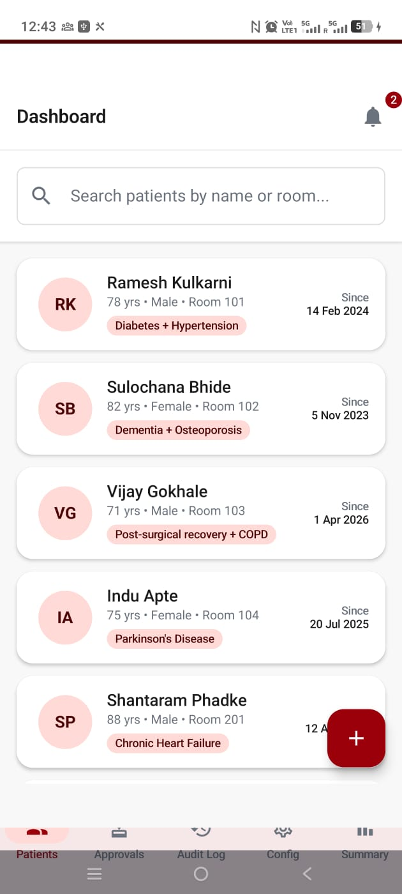

# Kalaza Care

A patient-management Android app built for **Kalaza Care**, an elder-care NGO in Pune — replacing paper-based intake, medication, and vitals tracking with a role-based, real-time system for staff, supervisors, and admins.

> **Status:** in active testing with the NGO. All data in this repo — patients, staff names, screenshots — is synthetic/mock, generated for development and demo purposes. The app is not yet handling real resident data.



## Why it exists

Kalaza Care's staff were tracking patient vitals, medication schedules, and care notes on paper. That made it hard to know at a glance whether a dose was actually given on time, hard to escalate a missed dose to the right person, and hard to keep a reliable audit trail. This app digitizes that whole workflow for three roles — Staff, Supervisor, and Super Admin — each with different responsibilities and access.

## What it does

- **Two-checkpoint medication workflow** — a Supervisor allots a dose, then Staff administers it, each step confirmed by scanning the patient's QR code. A dose can't quietly slip through without a hand-off.
- **Three-tier escalation watchdog** — a scheduled Supabase Edge Function checks every pending dose every minute: a reminder 15 minutes before it's due, an alert to the Supervisor 5 minutes late, and an escalation to the Super Admin 10 minutes late — all timed to the facility's local (IST) clock.
- **Batch QR-scan administration** — staff scan a patient's QR code once to unlock every dose due for that time-of-day window, with a 6-second confirmation hold before anything is marked given, so nothing gets rubber-stamped by accident.
- **Wi-Fi-scoped login** — the app only allows sign-in from the facility's own network, checked by gateway IP.
- **Role-based access control** — Staff, Supervisor, and Super Admin each see a different navigation bar and are gated at both the UI and data layer; edits from non-admin roles route through an approval queue instead of applying directly.
- **Live dashboards** — a Super Admin overview with real-time stats and a "needs your attention" feed of every open approval and allotment request.
- **Dependency-free `.xlsx` export** — per-patient medication summaries, built by hand-writing the OOXML spreadsheet format rather than pulling in a spreadsheet library.
- **Push notifications** — Firebase Cloud Messaging (FCM v1), triggered by a Supabase database webhook the moment a notification row is inserted.

## Tech stack

**Client:** Kotlin, Jetpack Compose (Material 3), MVVM + `StateFlow`, CameraX + ML Kit (QR scanning)
**Backend:** Supabase — Postgres with Row-Level Security, Auth, Realtime, and Edge Functions (Deno/TypeScript)
**Notifications:** Firebase Cloud Messaging, `pg_cron` for scheduled checks

## Architecture

Single-module Android app, cleanly layered:

```
data/model/        domain entities, no persistence annotations
data/remote/        Supabase client setup
data/repository/    one repository per domain area, backed by Supabase Postgrest
ui/<feature>/        one Composable screen per feature (dashboard, scan, medicine, patient, config...)
ui/components/      shared widgets
util/                session state, Wi-Fi gating, date/xlsx utilities, error handling
service/             FCM message handling
supabase/functions/  the escalation watchdog and push-notification Edge Functions
```

There's no local database or offline cache — every screen reads and writes straight to Supabase over HTTPS, with Supabase Realtime subscriptions keeping open screens in sync when another device makes a change.

Every table has Row-Level Security enabled, gated by role-check functions (`is_active_staff()`, `is_supervisor_or_above()`, `is_super_admin()`), so access control is enforced at the database layer, not just in the app.

## Running it locally

You'll need a Supabase project (with the schema from this repo's tables applied) and a Firebase project for push notifications.

1. Set up `app/google-services.json` from your own Firebase project.
2. Point `SupabaseClients.kt` at your Supabase project URL and anon key.
3. Deploy the two Edge Functions in `supabase/functions/` and set `SUPABASE_SERVICE_ROLE_KEY` / `FCM_SERVICE_ACCOUNT_JSON` as Supabase secrets.
4. Schedule `medication-watchdog` to run every minute via `pg_cron`.
5. Build and run `app/` from Android Studio.

## Project docs

`context/requirements.md` and `context/project_state_and_workflows.md` are the working design docs from development — they track every feature, schema table, and bug found and fixed along the way, including a couple of real ones (a notification tier that briefly targeted a role that no longer existed, and an RLS policy that was silently blocking non-admins from a screen they were supposed to have access to).
